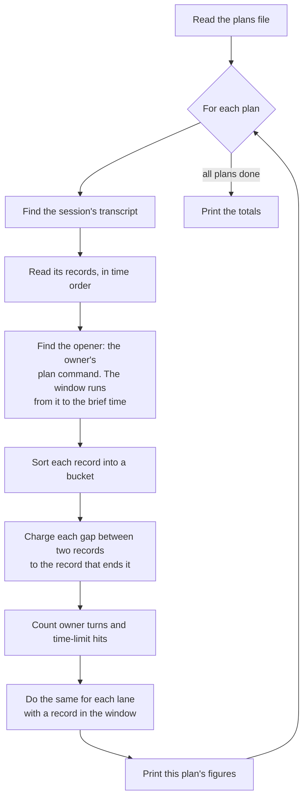

# plantime

`scripts/plantime.mjs` measures where a shawarma plan's wall-clock time went. It reads Claude Code transcripts and splits the plan's time into buckets: the model working, commands running, the owner thinking, lanes running, and so on.

It prints durations and counts only, never message text, because transcripts may hold private data. For the same reason, its error messages never name a path.

## How it works



## Running it

```sh
node scripts/plantime.mjs <transcripts dir> <plans file> [--json] [--suite|--probe|--lint|--vcs <regex>]
```

| Argument | Meaning |
|---|---|
| `<transcripts dir>` | One project's folder under Claude Code's `projects/`. It holds one `<session id>.jsonl` per session, and each session's lanes (subagents) under `<session id>/subagents/`. |
| `<plans file>` | The plans to measure. See [The plans file](#the-plans-file). |
| `--json` | Print the figures as JSON instead of text. |
| `--suite`, `--probe`, `--lint`, `--vcs <regex>` | Replace the regex that sorts shell commands into that bucket. The defaults are `DEFAULTS` in the script. |

## The plans file

One plan per line, fields separated by spaces:

```
<ticket> <session> <brief time> [<start time>]
skills-s262 abcd1234 2026-10-18T09:12:00+02:00      # an example
```

- `<ticket>` is the ticket as typed in the plan command.
- `<session>` is the session id, or a unique prefix of it: 4 or more characters of `0-9`, `a-f` and `-`.
- Times are ISO 8601 date-times with an offset or `Z`. The brief time is the brief commit's time: `git log -1 --format=%cI <commit>`.
- `<start time>` is optional. It replaces the opener as the window's start.
- A line or field starting with `#` starts a comment.

The file may be a regular file or a pipe:

- A named pipe is read until its writer closes it. It is refused after 10 s with nothing new to read.
- A pipe the shell hands over (`<(…)`) is, on some systems (macOS), read until its command ends.

## Terms

| Term | Meaning |
|---|---|
| Opener | The first `plan <ticket>` command in the session before the brief time. Only a command the owner gave counts: a slash command (with no origin or the owner's, its text opening with the command's tag), or a typed `/…shawarma plan <ticket>`. A command that a record merely quotes never counts. |
| Window | From the opener (or the start time) to the brief time. |
| Gap | The time between two consecutive records. Each gap is charged to the record that ends it. |
| Bucket | What a gap is charged to. See [Buckets](#buckets). |
| Lane | A subagent transcript with at least one record inside the window. |
| Accompanying record | A meta record, a reminder or a compaction. It does not wake the session. Its gap passes to the next record if that record wakes the session (an owner turn, a notification, a message). Otherwise the gap goes to `other` (or `compaction`). |
| Usable record | A user or assistant record with a real timestamp. |

## What it prints

For each plan:

| Figure | `--json` key | Meaning |
|---|---|---|
| wall | `wallMs` | The window's length. |
| attributed | `attributedMs` | The gaps charged to buckets. A gap that crosses the window's start or end is dropped, so this can be less than wall. |
| orchestrator buckets | `buckets` | The session's time, by bucket (ms). |
| lanes, lane buckets | `lanes`, `laneBuckets` | The number of lanes, and their time by bucket (ms). Each lane is split like the session, then all lanes are summed. Lanes that overlap are counted twice. |
| plan commands in window | `planCommands` | The owner's `plan <ticket>` commands from the window's start on. |
| owner turns | `ownerTurns` | See [Owner turns](#owner-turns). |
| owner wait per turn | `ownerWaitsMs` | Each turn's wait. The text output shows the median and the max. The median of an even count is the lower of the two middle values. |
| tool calls that hit their time limit | `timeLimitHits` | See [Time-limit hits](#time-limit-hits). |
| records not read | `unreadableRecords` | Lines that are not JSON, and user or assistant records with no real timestamp. Counted over the whole session file and over each lane. |
| lane files skipped | `lanesSkipped` | Lane files and folders that could not be read. See below. |

A plan that could not be measured has only `ticket` and `notRun` (the reason). See [When a plan cannot be measured](#when-a-plan-cannot-be-measured).

After the plans, the totals: the session's and the lanes' time by bucket, and the share of non-owner time spent running commands (`exec:*`).

Skipped lane files, counted in `lanesSkipped`:

- a symbolic link, or anything named `*.jsonl` that is neither a regular file nor a folder, under `subagents/` (a folder is searched like any other);
- a session folder that is a link (links are never followed);
- a lane file or folder that cannot be opened;
- a lane file with bad lines and no usable record.

A file with no usable record and no bad line (empty, blank, or other record types only) is not a lane, and is not counted.

## Buckets

Wait buckets: the session is waiting on something.

| Bucket | Waiting on |
|---|---|
| `human` | The owner, including an AskUserQuestion answer. |
| `other-session-wait` | Another session's message. |
| `lane-wait` | A lane's report. |
| `exec-wait` | A background command or a Monitor. |
| `idle-for-coordinator` | The orchestrator (a lane waiting). |
| `scheduled` | A scheduled wake-up. |
| `external` | Anything else: a channel, a plugin. |
| `interrupt` | The owner interrupting. |
| `compaction` | Context compaction, when no wake-up record follows it. |
| `other` | Accompanying records with no wake-up record after them. |

Work buckets: the session is doing something.

| Bucket | Doing |
|---|---|
| `model` | The model writing. |
| `exec:suite` | Running a test suite (by the `--suite` regex). |
| `exec:probe` | Running a one-off script (by the `--probe` regex). |
| `exec:lint` | Running a linter (by the `--lint` regex). |
| `exec:other-shell` | Any other shell command. |
| `vcs/tracker` | git, gh or beans (by the `--vcs` regex). |
| `file-io` | Reading, searching or editing files. |
| `web` | Web fetches and searches. |
| `lane-launch` | Launching a background lane or a workflow. |
| `lane-fg` | A lane run in the foreground. |
| `tool:other` | Any other tool. |

## Owner turns

- A turn counts when its wait lies inside the window.
- Records at the opener's own instant belong to the opener.
- The first owner record after that instant starts a turn, even with nothing in between.
- A later owner record joins the turn before it when only accompanying records lie between them.
- A turn's wait runs from the last record before it that is not accompanying. With none, it runs from the file's first record.
- A turn whose wait crosses the window's start is not counted, nor are the owner records that join it.
- An AskUserQuestion answer is a turn. An interrupt (the harness's record, which has no origin) is not.

## Time-limit hits

- A hit is a tool call that the harness stopped, or moved to the background, at its time limit. It is also a background command that the harness stopped at its background time limit, as its task notification says.
- Only the harness's own words count, never a command's output or a lane's report that quotes them. How a notification is read is described beside the code: `notices()`, `harnessEnd()` and `isStopNotice`.
- Each call counts once per transcript file. A call moved to the background at its limit, then stopped, is one hit, whether the notification names it by call id or by task id.
- A call in the session and its notification in a lane are in two files, so they count twice.
- A call the file does not hold is known by the id the record names. The rules are beside `limitCalls()`.
- Elapsed time never counts: a call that ran long but completed is not a hit.

## When a plan cannot be measured

The plan reads `NOT RUN` with the reason, and the other plans still run.

- Claude Code deletes transcripts after `cleanupPeriodDays` (30 by default), so a plan older than that reads `NOT RUN`.
- Any other failure reads `NOT RUN` with the error's name.
