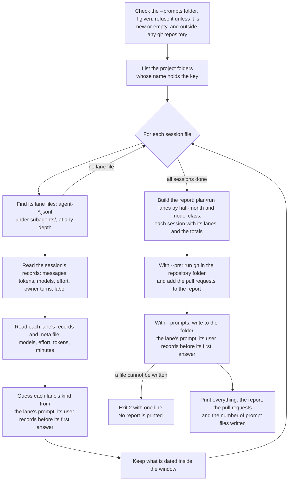

# runmeter

`scripts/runmeter.mjs` measures what Claude Code sessions cost and which model each lane ran on. It reads Claude Code transcripts. With `--prs` it also asks `gh` for the merged pull requests. It was written for the shawarma skill: its default lane kinds fit that skill's folders.

The tool measures sessions, not runs. A session is one Claude Code conversation, kept in one transcript file. A run is the work that follows one skill command, such as `/shawarma plan t-0001`. A lane is a subagent that the session started. The session that starts the lanes is the orchestrator. The owner is the person who types in the session.

A session that started at least one lane is printed. A session may hold more than one run, because the owner can give several commands in one session. The tool does not split them. See [Limits](#limits).

The tool never changes a transcript. It adds no rule to the skill and nothing for the orchestrator to remember. It can measure every past session whose transcripts are still on the machine.

It prints counts, durations, days and model names. With `--labels` it also prints the first two words of the command that opened each session. It prints no other message text, because transcripts may hold private data. See [Privacy rules](#privacy-rules).

## What each figure is for

| Figure | The decision it feeds |
|---|---|
| Lane model and effort | Which model and effort a lane kind runs on. |
| Prompt files (`--prompts`) | An audit of what a lane was told. |
| Tokens, lanes and minutes | What a session costs. |
| Owner turns | How often the owner is asked. |
| Open-to-merge minutes (`--prs`) | Whether the pull request is a checkpoint. A checkpoint is a point where someone or something examines the work before it goes on. A pull request that merges minutes after it opens, with no review, comment or check, was examined by nothing in between. |

## How it works



The steps run in this order:

1. The arguments are checked: the dates, the patterns, and that the `--prs` folder exists.
2. The `--prompts` folder is checked, before any transcript is read. A refused folder stops the tool here.
3. The transcripts are read and the report is built. Nothing is printed yet.
4. With `--prs`, `gh` is asked.
5. With `--prompts`, the prompt files are written.
6. Everything is printed at once.

If the prompt files cannot be written, the tool exits 2 and prints no report.

## Running it

```sh
node scripts/runmeter.mjs <projects dir> <project key> [--since <YYYY-MM-DD>] [--until <YYYY-MM-DD>] [--json] [--labels] [--prs <repo dir>] [--prompts <out dir>] [--plans|--retro|--replay <regex>]
```

| Argument | Meaning |
|---|---|
| `<projects dir>` | Claude Code's `projects/` folder. It holds one folder per project path. A repository's main checkout and each of its git worktrees have their own folder. |
| `<project key>` | A substring. Every project folder whose name holds it is read. Choose a key that the main checkout's folder and its worktrees' folders share. The key can also match a sibling project whose folder name holds it: the key `demo` also matches the folder of a project named `demo-site`. So check the `project folders` count in the totals. It should be the number of folders you meant to read. |
| `--since`, `--until <YYYY-MM-DD>` | Keep only what is dated from the first day to the second, both included. See [The date window](#the-date-window). |
| `--json` | Print the figures as one JSON document instead of text. |
| `--labels` | Also print each session's label: the first two words of the command that opened it. Without this flag no label is printed. See [Session label](#session-label). |
| `--prs <repo dir>` | Also run `gh` inside that folder and print the merged pull requests. See [Pull requests](#pull-requests). |
| `--prompts <out dir>` | Also write to that folder the lane's prompt: its user records before its first answer. See [Prompt files](#prompt-files). |
| `--plans`, `--retro`, `--replay <regex>` | Replace the pattern that sorts lanes into that kind. See [Lane kind](#lane-kind). |

An example, with an invented key:

```sh
node scripts/runmeter.mjs ~/.claude/projects my-repo --since 2026-09-01 --prs ~/code/my-repo
```

Exit codes:

| Code | Meaning |
|---|---|
| 0 | The figures were printed. A `gh` failure does not change this. Nor does a project folder, a session file or a lane file that is skipped: each is counted in the totals. |
| 2 | The input cannot be used: a missing folder, no project folder matching the key, no matching project folder that can be read, a bad date, a bad regex, a refused `--prompts` folder, a prompt file that cannot be written. One line says why. It never names a path. No figure is printed. |
| 1 | Any other failure. Only the error's name is printed. |

## Terms

| Term | Meaning |
|---|---|
| Project folder | A folder in `<projects dir>` whose name holds the key. A link to a folder is not read. |
| Session file | `<project folder>/<session id>.jsonl`: one session's transcript. A link to a file is not read. |
| Lane file | `agent-<id>.jsonl` under `<session id>/subagents/`, at any depth. Other files there, such as a workflow's `journal.jsonl`, are not lanes. Links are never followed. |
| Meta file | `agent-<id>.meta.json`, beside the lane file. The launcher writes it. |
| Usable record | A user or assistant record with a real timestamp. Only usable records are read. |
| Day | A UTC day, `YYYY-MM-DD`. |
| Half-month | Days 1 to 15 are the `first half`. The rest of the month is the `second half`. |
| Lane's prompt | The text of the lane's user records before its first answer: what the lane was told before it wrote anything. Its first answer is its first assistant record. See [Lane kind](#lane-kind). |
| Model class | `opus`, `sonnet` or `haiku` when the resolved model id holds that word. `other` for any other id. `unknown` when the lane has no model id, or when its id is not one plain word. [Privacy rules](#privacy-rules) says what a plain word is. |

## What it prints

The text output has four parts. With `--prs` the pull requests follow them, and with `--prompts` a last line gives the number of prompt files written. `--json` prints the same figures under the keys shown. The JSON also holds a few figures that the text leaves out; they are marked "JSON only".

A value that is missing prints as `?` and is still counted. The same holds for a value that is not one plain word (see [Privacy rules](#privacy-rules)). In JSON, a missing single value is the string `?` and a missing list is empty.

An example, from invented transcripts (the test fixture). It is the default output, so it shows no label:

```
# plan/run lanes by half-month and model class (UTC days)
half-month           opus  sonnet  haiku  other  unknown
2026-09 second half     0       1      0      0        1
2026-10 first half      1       0      0      1        0
last day a plan/run lane ran on a Sonnet- or Haiku-class model: 2026-09-20
other models: claude-fable-5-1 1
## aaaaaaaa 2026-09-20 · 90m · orchestrator claude-opus-5-5 · effort high/max · messages 3 · owner turns 3 · lanes 4 · orchestrator tokens in 60 out 600 cache-write 6.0k cache-read 60.0k · lane tokens in 110 out 1.5k cache-write 10.1k cache-read 100.7k
   a1a1a1a1 2026-09-20 plan/run general-purpose · launch sonnet · requested ? · resolved claude-sonnet-5 · effort high · 12.5m · messages 2 · tokens in 8 out 502 cache-write 73 cache-read 704 · launched with defaults: yes
   b2b2b2b2 2026-09-20 retro workflow-subagent · launch ? · requested claude-opus-5-5 · resolved claude-opus-5-5 · effort medium · 2m · messages 2 · tokens in 101 out 1.0k cache-write 10.0k cache-read 100.0k
   c3c3c3c3 2026-09-20 replay ? · launch ? · requested ? · resolved claude-haiku-4-5-20251001 · effort ? · 1m · messages 1 · tokens in 1 out 2 cache-write 3 cache-read 4
   d4d4d4d4 2026-09-20 plan/run ? · launch ? · requested ? · resolved ? · effort ? · 1m · messages 2 · tokens in 0 out 0 cache-write 0 cache-read 0
## bbbbbbbb 2026-10-03 · 1445m · orchestrator claude-fable-5-1 · effort medium · messages 2 · owner turns 2 · lanes 3 · orchestrator tokens in 3 out 30 cache-write 300 cache-read 3.0k · lane tokens in 4 out 8 cache-write 12 cache-read 16
   e5e5e5e5 2026-10-03 plan/run general-purpose · launch ? · requested ? · resolved claude-fable-5-1 · effort ? · 2m · messages 1 · tokens in 1 out 2 cache-write 3 cache-read 4 · launched with defaults: no
   a7a7a7a7 2026-10-03 plan/run workflow-subagent · launch ? · requested ? · resolved claude-opus-5-5 · effort ? · 3m · messages 2 · tokens in 2 out 4 cache-write 6 cache-read 8
   f6f6f6f6 2026-10-04 other Explore · launch opus · requested ? · resolved claude-opus-5-5 · effort ? · 2m · messages 1 · tokens in 1 out 2 cache-write 3 cache-read 4
# TOTAL: sessions with lanes 2 (session files 3, project folders 2) · lanes 7 (plan/run 4, retro 1, replay 1, other 1) · owner turns 5 · session minutes 1535 · lane minutes 23.5 (summed, overlap not removed)
  orchestrator tokens in 63 out 630 cache-write 6.3k cache-read 63.0k
  lane tokens in 114 out 1.5k cache-write 10.1k cache-read 100.7k
```

### 1. plan/run lanes by half-month and model class

`--json` key: `lanesByHalfMonth`.

| Figure | `--json` key | Meaning |
|---|---|---|
| one row per half-month | `rows`, each with `halfMonth` | The lanes of kind `plan/run` whose first record falls in that half-month. |
| the five columns | `opus`, `sonnet`, `haiku`, `other`, `unknown` | The count of those lanes by model class. A lane that used more than one model is classed by the model that wrote most of its messages. |
| last day a plan/run lane ran on a Sonnet- or Haiku-class model | `lastSonnetOrHaikuDay` | The latest first-record day among those lanes. `none` (JSON `null`) when there is no such lane. |
| other models | `otherModels` | Each model id counted under `other`, with its count. Printed only when there is one. |

### 2. One line per session

Only sessions with at least one lane are printed, oldest first. `--json` key: `sessions`.

| Figure | `--json` key | Meaning |
|---|---|---|
| session | `id` | The first 8 characters of the session id. |
| day | `day` | The day of the session's first record. |
| label | `label` | Printed only with `--labels`. See [Session label](#session-label). `null` without the flag, and when there is none. |
| minutes | `minutes` | See [Minutes](#minutes). |
| orchestrator | `models` | The resolved model ids of the session's own messages, the most used first. `?` when a record names none. |
| JSON only | `modelClasses` | The model classes of those ids, in the same order, each once. |
| effort | `effort` | The distinct `effort` values on the session's assistant records, in order of first use. |
| messages | `messages` | The session's own assistant messages. Each message id counts once. |
| owner turns | `ownerTurns` | See [Owner turns](#owner-turns). |
| lanes | `lanes` | The number of lanes. In JSON, the lanes themselves. |
| orchestrator tokens | `tokens` | The four token figures of the session's own messages. See [Tokens](#tokens). |
| lane tokens | `laneTokens` | The four token figures, each summed over the session's lanes. |
| JSON only | `laneFilesSkipped`, `recordsNotRead` | This session's share of the two totals of the same name. |

### 3. One line per lane

Under each session, its lanes, oldest first.

| Figure | `--json` key | Meaning |
|---|---|---|
| agent | `agent` | The first 8 characters of the agent id, from the file name. |
| day | `day` | The day of the lane's first record. |
| kind | `kind` | `plan/run`, `retro`, `replay` or `other`. See [Lane kind](#lane-kind). |
| agent type | `agentType` | `agentType` in the meta file, such as `general-purpose`. |
| launch | `launchModel` | `model` in the meta file: the model the launcher named for this lane. It is often a short name such as `sonnet`. It is `?` when the meta file names none; `resolved` then shows what the lane ran on. |
| requested | `requested` | The distinct `requestedModel` values on the lane's assistant records. Older transcripts do not have this key. |
| resolved | `resolved` | The distinct model ids on the lane's assistant messages: the models that answered. The most used comes first. |
| JSON only | `modelClass` | The model class of the first `resolved` id. |
| effort | `effort` | The distinct `effort` values on the lane's assistant records. |
| minutes | `minutes` | See [Minutes](#minutes). |
| messages | `messages` | The lane's assistant messages. Each message id counts once. |
| tokens | `tokens` | The four token figures. See [Tokens](#tokens). |
| launched with defaults | `launchedWithDefaults` | `yes` or `no` when the meta file has `launchedWithDefaults`. Not printed (JSON `null`) when it does not. |
| JSON only | `recordsNotRead` | The lane file's share of the total of the same name. |

### 4. Totals

`--json` key: `totals`.

| Figure | `--json` key | Meaning |
|---|---|---|
| sessions with lanes | `sessions` | The sessions printed. |
| session files | `sessionFiles` | Every session file in the project folders read, with or without lanes, inside the window or not. |
| project folders | `projectFolders` | The folders whose name holds the key, read or skipped. |
| lanes | `lanes`, `lanesByKind` | The lanes printed, and their count by kind. |
| owner turns | `ownerTurns` | Summed over the sessions printed. |
| session minutes, lane minutes | `sessionMinutes`, `laneMinutes` | Summed. Lanes that ran at the same time are each counted, so lane minutes can exceed session minutes. |
| orchestrator tokens, lane tokens | `tokens`, `laneTokens` | The four token figures, each summed over the sessions printed. |
| project folders skipped | `projectFoldersSkipped` | Those of the project folders that could not be listed, such as one the account may not read. The others are still measured. |
| session files skipped | `sessionFilesSkipped` | Session files that have lane files but could not be measured: unreadable, no usable record, or no readable lane. |
| lane files skipped | `laneFilesSkipped` | Lane files that could not be read or hold no usable record. |
| records not read | `recordsNotRead` | Lines that are not JSON, and user or assistant records with no real timestamp, in the files that were read. |

The four "skipped" and "not read" figures are printed only when they are not zero. A folder or file that cannot be read has no date, so the date window applies to them only in part: `projectFoldersSkipped` covers every project folder, `sessionFilesSkipped` covers every session file, `laneFilesSkipped` covers every lane file of the sessions printed, and `recordsNotRead` covers the session files of the sessions printed and their kept lanes.

## Tokens

Each assistant message carries a `usage` object. The tool reads four of its fields and prints four figures:

| Figure | `--json` key | `usage` field | Meaning |
|---|---|---|---|
| in | `input` | `input_tokens` | Input tokens that were neither read from the prompt cache nor written to it. |
| out | `output` | `output_tokens` | Tokens the model produced. |
| cache-write | `cacheWrite` | `cache_creation_input_tokens` | Input tokens written to the prompt cache. |
| cache-read | `cacheRead` | `cache_read_input_tokens` | Input tokens read from the prompt cache. |

The four figures are never added into one "tokens" figure, for two reasons:

- They are priced differently, and the prices depend on the model. A cache read costs a small part of what an uncached input token costs. An output token costs several times more. Prices change, so check the current price list before turning tokens into money.
- Cache reads are far larger than the other three. Each request reads the whole conversation so far again. A sum would be mostly cache reads. It would say little about cost and nothing about work done.

How messages are counted:

- A message id is counted once. The transcript repeats a message's usage on several records, with the output count growing. The tool keeps the highest value of each field.
- A record with no message id is a message of its own.
- A record whose model is `<synthetic>` was written by the harness, not by a model. It is not a message, and its usage is not counted.
- A usage field that is missing counts as 0.

The text output shortens large figures: `1.5k` is about 1,500 and `2.5M` is about 2,500,000. `--json` holds the exact counts.

## Owner turns

An owner record is a record that `classify()` in `scripts/plantime.mjs` reads as `human`: text or a command the owner typed, or the owner's answer to an AskUserQuestion.

- Owner records that follow one another are one turn.
- Records that only accompany another (a reminder, a meta record, a compaction) neither start nor end a turn.
- An interrupt is not a turn.
- A tool call that the owner rejects with a typed reason is not counted. The transcript holds the reason as the result of that tool call, not as an owner record. A rejection with no reason is not counted either. The one exception is an AskUserQuestion call: its result is always read as the owner's answer.
- The command that opens the session is a turn. So the figure counts the times the owner spoke, asked or unasked, except for those typed reasons.
- Only the session file is read. Nothing the owner does inside a lane is counted.

## Minutes

Minutes run from the first usable record to the last, for a session file or a lane file. They are wall-clock minutes, with one decimal.

They include all waiting: the owner thinking, a session left open overnight, a lane waiting on a command or on the orchestrator. A session that is resumed over several days counts those days. To see where time went inside a plan, use `scripts/plantime.mjs`.

## Session label

A label says which command opened the session. For `/shawarma plan t-0001` the label is `plan t-0001`.

A label is printed only with `--labels`. Without the flag there is none: the text output shows no label, and the JSON `label` is `null`. The label is off by default because it is text the owner typed. It can hold a ticket id or a name. It is the only message text the tool ever prints.

Where the label comes from:

- It comes from the first owner record that is a skill command and that gives a label.
- A skill command is known by how the harness writes it: the record opens with `<command-message>`. A built-in command such as `/clear` opens with `<command-name>` and is never read. A command typed as plain text is never read either.
- Only the command's arguments are read: what the owner typed after the command name.

What the label holds:

- At most two words: the first two words of the arguments. Words are separated by spaces, tabs or line breaks. Anything after the second word is never read.
- A word is 1 to 24 characters, each one a letter from `A` to `Z` or `a` to `z`, a digit, or one of `. _ -`. A slash is not allowed, so a path is never a word.
- Reading stops at the first word that is not such a word. `/shawarma plan docs/plans/x.md` gives `plan`. `/shawarma run t-0002, then stop` gives `run`, because `t-0002,` ends with a comma.
- If the first word already fails, that command gives no label. The next skill command is then tried.
- A session with no such command has no label.

## Lane kind

The kind is a guess from the lane's prompt: its user records before its first answer. The prompt itself is never printed.

What the prompt is:

- The first answer is the lane's first assistant record. The prompt is the text of every user record that comes before it.
- Many lanes have one such record: their task.
- A lane started by a workflow tool has two: a relay of the owner's request, then the lane's own task. The two are read together, joined with a blank line.
- A meta record is left out. A meta record is one that the harness marks `isMeta`, such as a reminder.
- A user record that comes after the first answer is not part of the prompt.

Three patterns are tried on the prompt in this order, ignoring case. The first that matches decides.

| Order | Kind | The prompt… | Flag |
|---|---|---|---|
| 1 | `replay` | carries a replay marker | `--replay` |
| 2 | `retro` | names `docs/retros/` | `--retro` |
| 3 | `plan/run` | names `docs/plans/` | `--plans` |
| 4 | `other` | matches none | |

A replay is a lane that a shawarma retro starts to run a planning method again on a past ticket, or to score such a run. The past tickets it uses are the trap bank. A replay marker is wording such a prompt uses: the word replay shortly before plan, planning, method or ticket, or the role scorer or proxy shortly before rubric, trap or rulings. These are a first guess. On the transcripts the defaults were checked against, 30 of 30 lanes read as `plan/run` were sorted right, and 6 of 30 read as `replay` or `retro` were sorted wrong: mostly scorers, proxies and planners of a replay whose prompts lack these words. Such a planner counts as `plan/run` in the half-month table. When your replay prompts say something else, pass `--replay`.

The default patterns are `DEFAULTS` in the script:

```
--replay  \breplay(s|ed|ing)?\b.{0,40}\b(plan|planning|method|ticket)|\b(scorer|proxy)\b.{0,60}\b(rubric|trap|rulings?)\b
--retro  docs/retros/
--plans  docs/plans/
```

Limits of the guess:

- It reads words, not intent. A lane whose prompt names `docs/plans/` for any reason is `plan/run`.
- The order matters. A lane that names `docs/plans/` and also carries a replay marker anywhere, even once near its end, is `replay`.
- The relay is read with the task. So a lane started by a workflow tool can be sorted by what the owner asked. If the relay names `docs/retros/` and the task names `docs/plans/`, the lane is `retro`.
- `other` holds everything else: explorers, lanes of other skills, and any lane whose prompt matches no pattern.
- The defaults fit shawarma's folders. For another layout, pass your own patterns.

## The date window

`--since` and `--until` are UTC days, both included. With a window:

- A lane is kept when its first record is dated inside the window. A kept lane is counted whole.
- A session's own figures (minutes, messages, tokens, owner turns, label, day) come only from its records dated inside the window.
- A session is printed when it has at least one kept lane and at least one record of its own inside the window.
- Only pull requests opened inside the window are counted.

The window cuts by date, not by session. A session that spans the window's edge is counted in part.

## Pull requests

With `--prs <repo dir>` the tool runs this inside the folder:

```sh
gh pr list --state merged --limit 1000 --json number,createdAt,mergedAt,reviews,comments,statusCheckRollup
```

`--json` key: `prs`.

| Figure | `--json` key | Meaning |
|---|---|---|
| one line per merged pull request | `rows`, each with `number` | Its number. |
| open to merge | `minutes` | Minutes from `createdAt` to `mergedAt`. |
| reviews, comments, checks | `reviews`, `comments`, `checks` | The number of entries in `reviews`, `comments` and `statusCheckRollup`. |
| merged | `merged` | The number of pull requests listed. |
| median open to merge | `medianMinutes` | The middle value. For an even count, the mean of the two middle values. |
| with any review, comment, check | `withReview`, `withComment`, `withCheck` | How many have at least one. |
| gh limit reached | `limitReached` | `gh` returned 1000 pull requests, so older ones are missing. |

If `gh` is missing or fails, the tool prints `prs: NOT RUN (<reason>)` (JSON `notRun`) and the rest of the report stands. The reason is one of these:

| Reason | When |
|---|---|
| `gh not found` | `gh` is not installed, or is not on the `PATH`. |
| `gh exited <code>` | `gh` ended with that exit code, which is not 0. For example, it is not signed in, or the folder is not a GitHub repository. |
| `gh failed: killed` | A signal ended `gh`. |
| `gh failed: <error code>` | `gh` could not be started, or the tool stopped it. The code is the system's: `EACCES` when `gh` may not be run, `ETIMEDOUT` when it took more than 120 seconds, `ENOBUFS` when it printed more than the tool reads. |
| `gh output is not JSON` | `gh` ended with exit code 0 and printed something that is not JSON. |
| `gh output is not a list` | The JSON that `gh` printed is not a list. |

What `gh` wrote on its error stream is discarded.

The pull requests are the repository's. They are not matched to sessions.

## Prompt files

With `--prompts <out dir>` the tool writes, for each lane, the lane's prompt: its user records before its first answer. [Lane kind](#lane-kind) says which records these are. The text is written as sent, one file per lane:

```
<out dir>/<session8>/<agent8>.prompt.txt
```

`<session8>` and `<agent8>` are the first 8 characters of the two ids, as printed on the session and lane lines. Two lanes that would share a file name get `-2`, `-3` after the agent id.

A prompt can hold private text: what the owner asked, names, paths, parts of files. The prompt files are the only output that holds whole prompts. So the folder must be new or empty, and outside any git repository.

The tool checks the folder twice: before it reads anything, and again just before it writes. It refuses in four cases. It then exits 2 with one line and writes nothing.

| The folder… | The line printed |
|---|---|
| exists and is not an empty real folder. A link is refused. A file is refused. A folder that holds anything is refused, and is left unchanged. | `--prompts folder exists and is not an empty real folder: refused` |
| is inside a git work tree, or inside git's own folder: a `.git` folder, or a repository that has no work tree. An ignore rule does not make the folder acceptable. | `--prompts folder is inside a git repository: refused` |
| could not be checked. git is missing, git failed for any reason other than "not a git repository", or a folder above it cannot be looked at. | `--prompts folder not checked: git not found`, `--prompts folder not checked: git failed`, or `--prompts folder not checked: a folder above it cannot be looked at` |
| cannot be looked at itself. | `--prompts folder not usable: <error code>` |

Why each rule is there:

- New or empty: the tool never writes over a file, and its files are never mixed with others.
- Outside any git repository: a file inside one can be committed and pushed. An ignore rule can be removed or bypassed, so it does not count.
- Refused when not checked: the tool cannot tell whether the folder is safe.

How the check is made:

- A folder that does not exist yet is checked through its nearest parent folder that exists. Links on the way to that parent are followed, so a path that leads into a repository is checked where it leads.
- The tool first looks for an entry named `.git` in that folder and in every folder above it. One such entry means a work tree, even when git cannot read it or it leads nowhere. The folder is refused.
- The tool then asks git about that folder with `git rev-parse --is-inside-work-tree`. Any answer means a repository. Only git's own error "not a git repository" lets the folder pass: git looked in the folder and in every folder above it, and found none.
- git is asked without the variables that move its idea of the repository: `GIT_DIR`, `GIT_WORK_TREE`, `GIT_COMMON_DIR`, `GIT_INDEX_FILE`, `GIT_OBJECT_DIRECTORY`, `GIT_NAMESPACE`, `GIT_CEILING_DIRECTORIES`, `GIT_DISCOVERY_ACROSS_FILESYSTEM` and `GIT_PREFIX`. So none of them can hide a repository. For this ask the tool sets `GIT_DISCOVERY_ACROSS_FILESYSTEM=1` itself, and `LC_ALL=C` so that git answers in English.
- When any of those variables is set, git is asked a second time with them. A repository that only the caller's variables name is a repository too.
- If the tool cannot look at the folder, it prints `--prompts folder not usable: <error code>` and exits 2.

Two limits of the check:

- It is made twice, not all the time. Do not move the folder, or put anything in it, while the tool runs.
- A work tree that only a repository elsewhere names (its `core.worktree` setting) is not seen: nothing in or above the folder points to it.

git is told to look past a filesystem boundary, so a folder on a disk that is mounted inside a work tree is still seen as inside it.

How the files are written:

- The tool creates the folder when it has a prompt to write and the folder is absent. It deletes nothing.
- Only the text of a prompt is written. An image in it is left out.
- Prompt files are private. Each folder the tool makes has mode `0700` and each file has mode `0600`: only the owner's account can read them. An empty folder that already exists keeps the mode it has.
- A file is only ever created, never written over. If a file of the same name has appeared since the check, it cannot be written.
- The files are written after the report is built and after `gh` is asked, and before anything is printed. See [How it works](#how-it-works).
- If a file cannot be written, the tool prints `--prompts folder not writable: <error code>`, exits 2 and prints no report. Files written before the failure stay.
- Otherwise the text output ends with the number of files written (`--json` key `promptFilesWritten`).

## Privacy rules

1. The output holds counts, durations, days, model ids, effort values, agent type names, pull request numbers, and the first 8 characters of session and agent ids. It holds no message text, no prompt and no full id. Rule 2 says what happens to a value that looks like a path.
2. A value read from a record or a meta file is printed only when it is one plain word. A plain word is 60 characters at most. It is made of letters from `A` to `Z` and `a` to `z`, digits, and `_ . : @ [ ] -`. It may also hold one `/`, but not as its first or last character. So a model id such as `vendor/model` prints. A path such as `/home/u/x` or `a/b/c` does not. Anything that is not a plain word prints as `?`. A value of two parts, such as `a/b`, is a plain word and prints.
3. The session label is the one exception to rule 1. It is printed only with `--labels`. It is two words at most, filtered as described under [Session label](#session-label).
4. An error message never names a path. A file error is reported by its code, such as `ENOENT`.
5. An unexpected failure prints the error's name only, because its message could quote a record.
6. `--prompts` is the only output that holds whole prompts. Its folder must be new or empty, and outside any git repository. See [Prompt files](#prompt-files).
7. Without `--prompts`, the tool writes no file.

Read the output before you share it:

- Model ids, agent type names and pull request numbers come from your own project.
- With `--labels`, each label is two words that the owner typed. Read every label first, or run the tool again without `--labels` and share that output.
- Do not share the prompt files unless you have read them. They hold whole prompts.

## Limits

- **Transcript retention.** Claude Code deletes transcripts after `cleanupPeriodDays` (30 by default). The tool can only measure sessions whose transcripts are still on the machine. To keep a longer history, raise that setting or keep the `--json` output of each run of the tool.
- **Formats change.** The field names were checked on Claude Code 2.1.3xx. Older transcripts lack some keys, such as `requestedModel`. A later version may rename a field. A missing value prints as `?` and is still counted; it never stops the tool.
- **One machine.** The tool reads the transcripts of the machine it runs on. Sessions held on another machine, or in the cloud, are not seen.
- **The key is a substring.** It can match a sibling project whose folder name holds it. Check the `project folders` count in the totals.
- **A session is a file, not a run.** A session that holds several commands, or is resumed over several days, is one line. With `--labels`, its label comes from its first skill command only. Splitting a session at each command is ticket `skills-cb5t`.
- **Messages copied between files.** A message id is counted once per file. If Claude Code copies a message into a second transcript, it is counted in each.
- **Lane kind is a guess.** See [Lane kind](#lane-kind).
- **Model class is read from the name.** A model whose id holds none of the three words is `other`, whatever it is.
- **Pull requests are capped.** `gh` returns at most 1000 merged pull requests.
